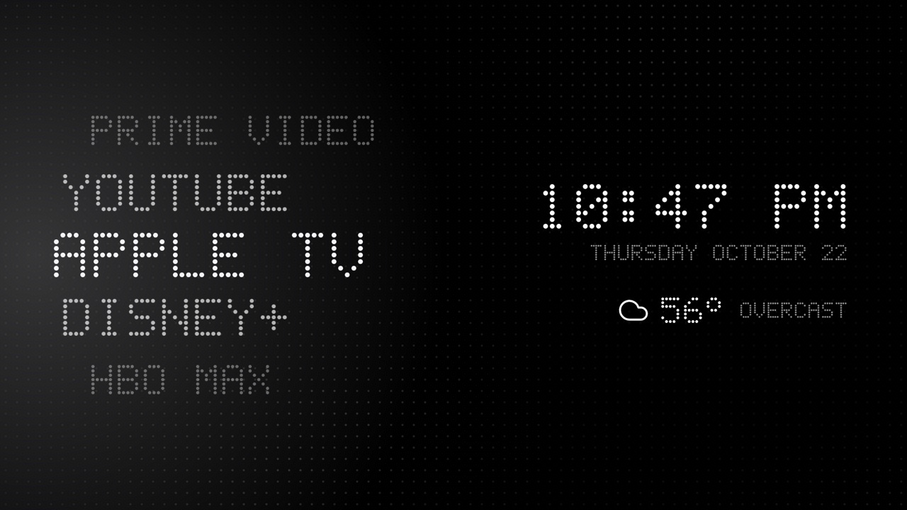

# TV Launchers

Custom home screens for Android TV / Google TV, plus the scripts to debloat a TV and install them over
ADB. Everything is reversible: nothing is rooted, flashed or uninstalled.



**Dot** (`launchers/dot`) is the first one: an LED dot-matrix home screen with an endless app wheel, the
time and weather, a slowly breathing background, and seasonal themes.

## Getting started

On the TV, turn on **Settings → System → Developer options → USB debugging** (unlock Developer options by
pressing OK on **About → Build** seven times). Then, on a Mac:

```bash
brew install openjdk@17 && brew install --cask android-commandlinetools
sdkmanager --sdk_root=/opt/homebrew/share/android-commandlinetools "platforms;android-34" "build-tools;34.0.0"
python3 -m venv tools/venv && tools/venv/bin/pip install -r tools/requirements.txt

export TV_HOST=192.168.1.50                      # the TV's IP address
tools/disable.sh tvs/sony-bravia-a80cj/debloat.txt
./install.sh tvs/sony-bravia-a80cj               # build Dot and make it the home screen
```

Accept the *Allow USB debugging?* prompt on the TV the first time. When you're done, switch USB debugging
off again.

## Settings

Each TV has a folder in `tvs/`. Its `tv.properties` holds everything specific to that TV: apps to hide,
the Live TV app, remote button codes, and the weather fallback city. Copy a folder to add another TV.

- **Birthdays:** add `birthdays=Name:MM-DD,Name:MM-DD` to the TV's `personal.properties` (gitignored).
- **On the TV:** hold OK on any app for Home screen settings: show or hide apps, preview a theme, burn-in care.
- After changing a file, run `./install.sh tvs/<tv>` again.

## Undo

```bash
./revert.sh tvs/sony-bravia-a80cj                    # re-enable everything, stock home screen back
./revert.sh tvs/sony-bravia-a80cj --remove-launcher  # ...and uninstall Dot
```

## Credits

Built on [cleanyourtv](https://github.com/Gathin23/cleanyourtv) by Gathin (ADB tools, debloat method),
with the wheel design and weather pixels from [Seeker TV](https://github.com/TWBankston/Seeker-TV-Launcher)
by TWBankston, icons from [Lucide](https://lucide.dev) and weather from [Open-Meteo](https://open-meteo.com).
MIT licensed.
